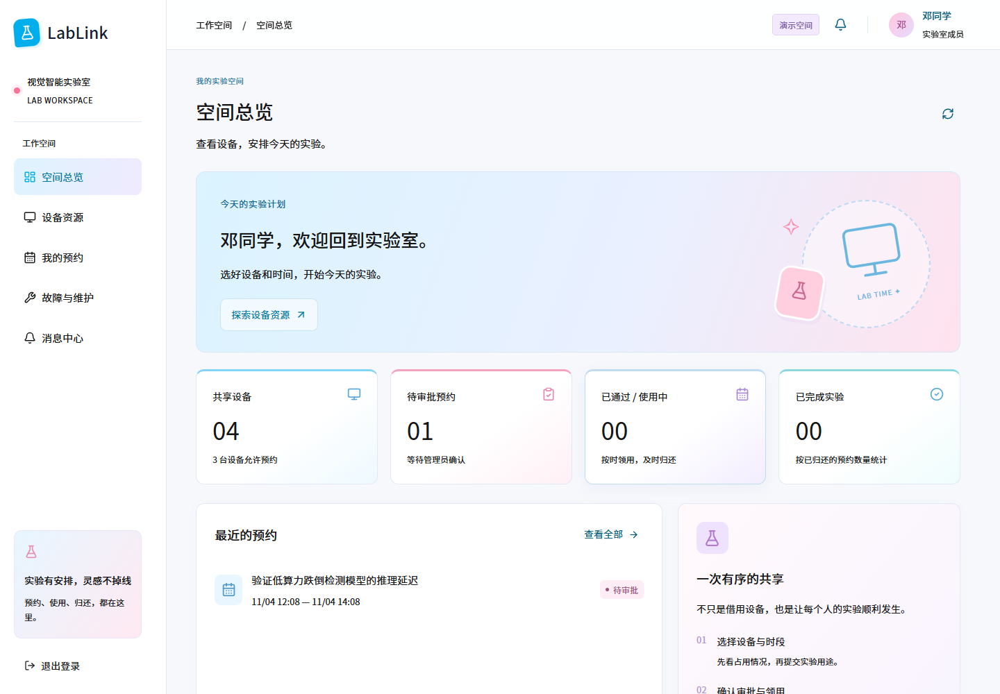
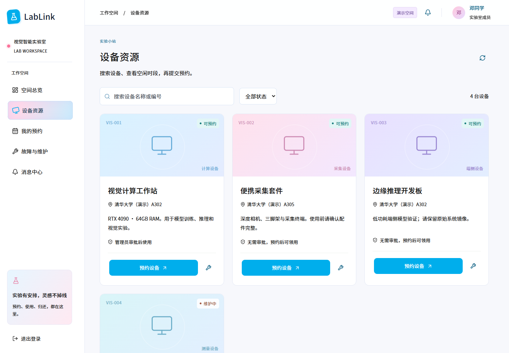

# LabLink · 实验室设备预约与共享平台

[](https://github.com/ylxnn/lablink/actions/workflows/lablink.yml)


从设备预约到归还，把实验室里的资源协作串成完整流程。

**设备目录 → 时段预约 → 管理员审批 → 领用归还 → 故障维修**



LabLink 是一个以 Python 后端工程为重点的全栈项目，基于 [FastAPI 官方全栈模板](https://github.com/fastapi/full-stack-fastapi-template) 开发。新增了预约领域模型、事务服务、角色与实验室权限、后台通知及对应前端。上游来源与改动范围见 [PROVENANCE](docs/PROVENANCE.md)。

## 解决的场景

视觉实验室共享工作站、采集套件和边缘开发板。成员需要知道设备何时空闲，管理员需要审批用途、处理故障，并保留使用记录。不同实验室的数据需要隔离。

设备、账号、学校名称和预约均为**合成演示数据**，不代表真实高校部署或合作。

## 功能与工程重点

| 模块 | 功能 / 约束 |
| --- | --- |
| 设备资源 | 名称和编号搜索、分页、审批策略、维护与停用 |
| 预约 | 半开时段 `[start,end)`，相邻时段可预约；冲突返回 409 |
| 提交可靠性 | 按用户隔离的 `Idempotency-Key`，同键同请求返回原记录 |
| 状态机 | 申请、审批、领用、归还、取消与过期；拒绝自审和无效跳转 |
| 权限 | 平台管理员 / 设备管理员 / 成员；接口检查实验室归属和记录所有权 |
| 故障 | 报修后暂停设备、取消待领用预约；全部故障处理后恢复 |
| 消息 | 业务与 Outbox 同事务提交，站内通知去重、退避重试和死信管理；一键全部已读 |
| 个人资料 | 姓名、学号、电话、简介；更改登录邮箱需验证当前密码 |
| 管理 | 操作审计、CSV 导出、管理员初始化、数据库备份 |

本地使用 **SQLite WAL + `BEGIN IMMEDIATE`** 保证预约读写检查的原子性。PostgreSQL 路径实现用户 / 设备行锁，迁移提供排他约束；此路径尚未在真实 PostgreSQL 环境完成验证。

## 快速运行

要求：**Python 3.12、Node.js 22、uv、Git**。不需要启动 Docker 或大模型。

```sh
git clone https://github.com/ylxnn/lablink.git
cd lablink
uv sync --frozen
cd frontend
npm ci --workspaces=false
npm run build
cd ..
```

启动本机演示：

```powershell
# Windows
.venv/Scripts/python.exe scripts/start_lab.py
# 也可以执行 ./start.ps1
```

```sh
# macOS / Linux
.venv/bin/python scripts/start_lab.py
```

打开 **http://127.0.0.1:42112/**。登录页可选择演示角色并自动填入账号。

| 身份 | 邮箱 | 演示密码 |
| --- | --- | --- |
| 实验室成员 | student@lablink.local | LabLink2026! |
| 设备管理员 | manager@lablink.local | LabLink2026! |
| 平台管理员 | admin@lablink.local | LabLink2026! |
| 其他实验室管理员 | robot@lablink.local | LabLink2026! |

这些公开账号仅供本机演示。默认应用不自动创建演示用户；启动脚本显式开启 `SEED_DEMO=true`，并仅监听 `127.0.0.1`。重复启动不会重置数据。电脑重启后重新运行同一启动命令即可。

配置、数据库、JWT 密钥、日志和备份保存在 `.env.lab` / `.local/`，均不纳入版本控制。

### 推荐演示流程

1. 成员查看设备已占用时间，提交一个未来空闲时段。
2. 切换设备管理员账号，查看用途并审批。
3. 成员在开始前 15 分钟至结束前领用，使用完毕后归还。
4. 发起重叠预约，观察冲突提示；重复提交同一请求不重复创建。
5. 报修设备，观察维护状态、预约取消和站内通知。
6. 切换另一实验室账号，检查资源隔离。



## 开发与测试

```sh
uv run pytest tests -q
uv run ruff check backend/app tests scripts --select F
cd frontend
npm run typecheck
npm run build
```

**当前 30 项后端测试通过**，包含 8 个并发重叠预约仅一个成功、幂等提交、越权访问、状态流转、报修联动、通知重试、资料保存和全部已读。并发案例验证一致性，不代表吞吐量指标。

开发前端可在 `frontend/` 执行 `npm run dev`；Vite 会代理到本机后端。API 文档：**http://127.0.0.1:42112/api/docs**。

浏览器验收需要系统 Chrome，或通过 `CHROME_PATH` 指定浏览器：

```sh
node scripts/verify_ui.cjs
node scripts/verify_theme.cjs
```

脚本默认连接本机演示，可通过 `LABLINK_BASE_URL` 指定隔离实例；验收会生成带前缀的测试预约。截图输出到 `.local/ui-tests/`，不会改写 README 的演示截图。

## 项目结构

```text
backend/app/
  core/              # 配置、数据库引擎、复用的密码 / JWT 工具
  lab/               # 领域模型、API、事务服务、通知 worker
  main.py            # 生命周期、异常处理、安全响应头、静态托管
backend/migrations/  # 独立 Alembic 迁移链
frontend/src/lab/    # React / TypeScript 页面与蓝粉视觉系统
scripts/            # 本机启动、管理员初始化、备份与浏览器验收
tests/              # 临时数据库上的业务和 HTTP 测试
docs/               # 架构、来源、验证范围和展示说明
```

上游未启用的 CRUD 路由、旧前端、生成客户端、测试及部署文件已从发布源码移除。初始迁移中的旧 `item` 表暂保留以保持迁移链稳定，不提供该表的业务接口。

## PostgreSQL 与部署

复制 `.env.lab.example` 为 `.env.lab`，填写数据库连接和独立随机密钥。在完成安装的环境执行：

```sh
cd backend
../.venv/bin/alembic -c alembic.lab.ini upgrade head
# Windows 使用 ../.venv/Scripts/alembic.exe
```

生产运行需设置 `APP_ENV=production`、`SEED_DEMO=false` 和显式的 `SECRET_KEY`（32 字符以上）。迁移后可从根目录运行 `python scripts/create_admin.py` 交互创建管理员。该脚本不会打印密码。

`compose.lab.yml` / `Dockerfile.lab` 提供可选 PostgreSQL 容器配方。**配置已提供，但容器和 PostgreSQL 真实联调尚未完成**，不作为已验证成果。

SQLite 备份使用 `python scripts/backup_local.py`；PostgreSQL 使用 `pg_dump`。恢复前须停止服务并保留现有文件。后续结构变化使用迁移，不将 `create_all` 当作数据库升级。

## 验证范围与边界

- 已验证：SQLite 业务测试、前端构建、浏览器跨角色流程、手机布局、本地迁移升级与结构检查。
- 待验证：真实 PostgreSQL 竞争条件、容器环境、开放部署安全和真实使用反馈。
- 通知为站内消息，不包含邮件、短信或微信服务。
- 登录限频为单进程内存实现；JWT 有效期 2 小时，无服务端登出吊销列表。
- 没有真实高校用户、门禁或物联网接入；不宣称生产落地、高并发业绩或用户规模。

[架构与取舍](docs/ARCHITECTURE.md) · [完整验证记录](docs/VERIFICATION.md) · [展示与讲解](docs/INTERVIEW.md)

## 许可证与致谢

应用代码采用 [MIT](LICENSE)，保留 FastAPI 官方全栈模板的版权声明。Noto Sans SC 字体单独采用 [SIL OFL 1.1](frontend/src/lab/fonts/OFL.txt)。字体许可不被应用的 MIT 许可替代。
