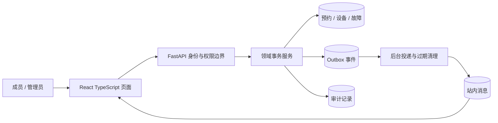
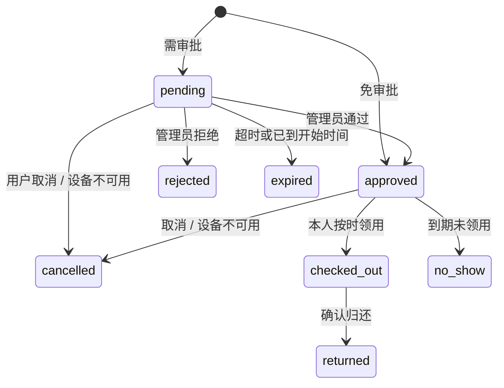

# 架构与设计取舍

所有时间存为 UTC 的无时区时间戳。输入必须携带时区，前端用浏览器时区呈现。时间区间为 `[start,end)`，相邻时段允许预约。

SQLite：事务开始先 `BEGIN IMMEDIATE`，避免“双方都查询到空闲再分别插入”的竞态，代价是全库写操作串行。适合轻量本机演示，不代表 PostgreSQL 的吞吐。

PostgreSQL：提交预约时先锁用户，再锁设备，保证跨设备的用户配额与同设备时段互斥；状态操作锁设备并刷新预约。迁移加入 `btree_gist` 排他约束作为应用代码之外的数据库防线。该路径尚待 PostgreSQL 实测。

业务事务同时写入 Outbox 和 Audit。后台将 Outbox 转成 Notification，事件键唯一约束避免重复通知记录。每条投递在事务内处理；数据库故障时回滚并下轮重试。重试分支有指数退避和最多 5 次的失败状态；不将测试故障注入等同于真实外部邮件投递验证。

## 状态机

不能自审。领用要求本人、设备可用、无其他未归还领用、处于允许时间窗口。逾期未归还仍保持使用中，不伪造“自动归还”。

## 为什么没有 Redis、微服务或 AI

这些组件不能替代数据库一致性和业务边界。当前单体加持久 Outbox 已覆盖场景；先验证用户量、延迟和故障，再决定是否引入共享队列与缓存。项目 1 展示 AI 工作流，本项目展示传统业务工程，避免为了技术名词重复建设。
